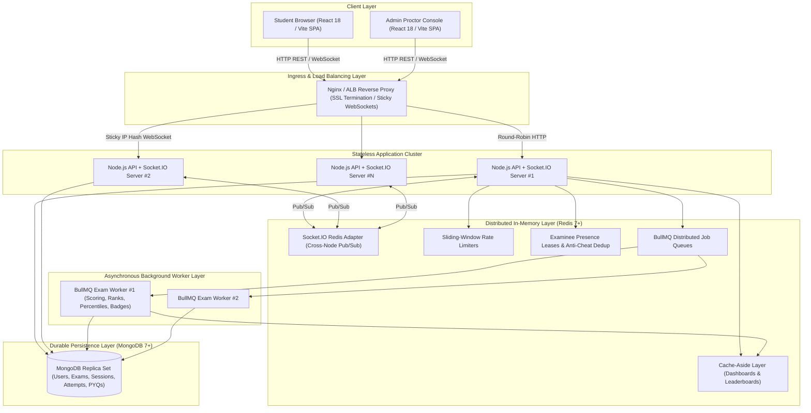
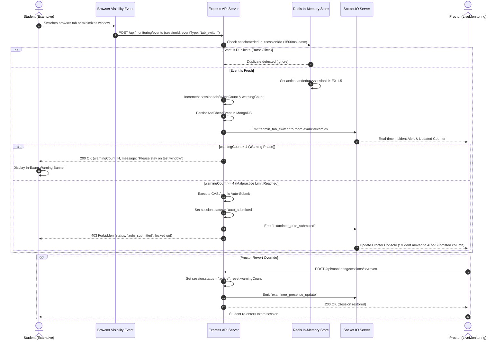
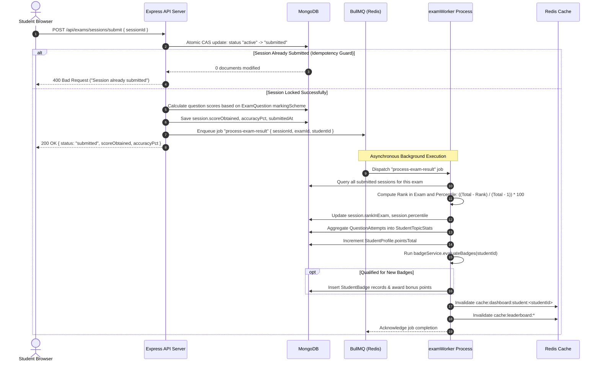
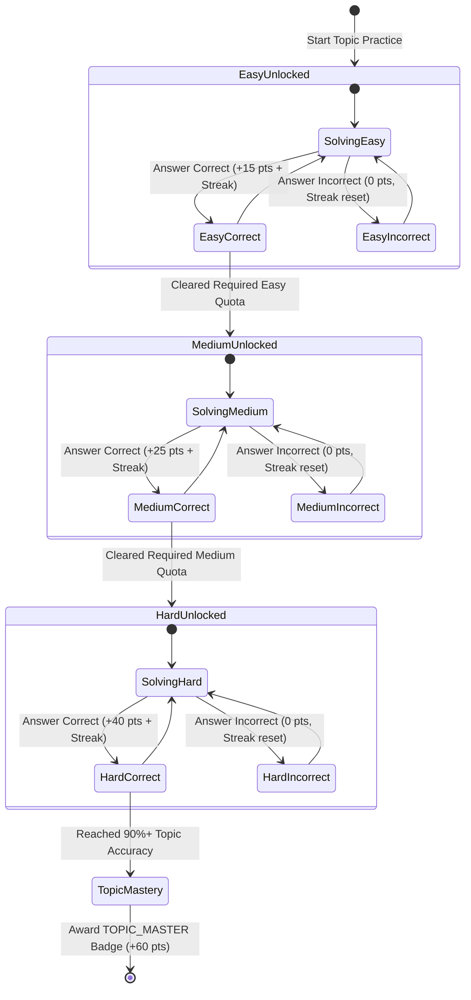
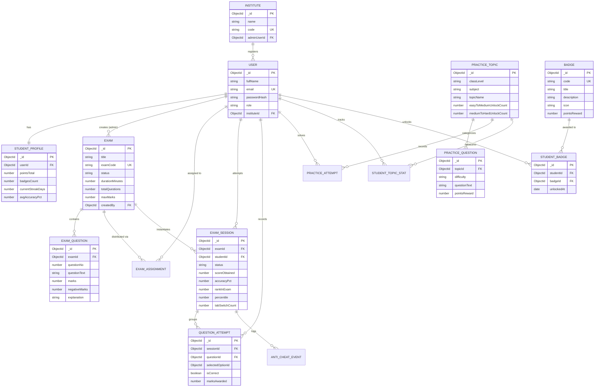

# Focus Flair Platform — Complete Application Architecture

This document provides a comprehensive technical architecture specification for the **Focus Flair** web application, featuring system topologies, sequence flows, data pipelines, entity-relationship diagrams, and scalability models.

---

## 1. High-Level System Architecture

The Focus Flair platform is architected around a distributed, decoupled, horizontally scalable topology designed to handle concurrent live examinations with real-time proctoring telemetry.

---

## 2. Real-Time Anti-Cheat Proctoring Architecture

The anti-cheat subsystem captures client-side tab switching and window blur events, deduplicates them through Redis, logs durable incident records, and broadcasts alerts instantly to the proctor's monitoring dashboard.

---

## 3. Exam Submission & Asynchronous Scoring Pipeline

To prevent slow response times and database deadlocks when hundreds of examinees submit simultaneously at the end of a timed test, Focus Flair employs a two-tier submission pipeline:
1. **Synchronous Tier**: Calculates durable exam marks immediately and returns a verified `200 OK` response to the examinee in under 50ms.
2. **Asynchronous Tier**: Enqueues heavy ranking, percentile distributions, topic mastery aggregations, and badge evaluations into BullMQ workers.

---

## 4. Adaptive Practice Engine State Machine

Practice Mode adapts dynamically to examinee proficiency by enforcing progression gates and difficulty milestones.

---

## 5. Entity-Relationship (ER) Diagram

---

## 6. Scalability, Security & High Availability Guarantees

### 6.1 Horizontal Scaling
* **Stateless Web Nodes**: Application instances do not retain in-memory user session state. Any incoming request can be served by any container behind the load balancer.
* **Sticky IP Sockets with Redis Cross-Talk**: Socket.IO connections use IP-hash affinity on Nginx, while `@socket.io/redis-adapter` relays events across nodes through Redis Pub/Sub channels.

### 6.2 Fault Tolerance & Idempotency
* **Compare-And-Swap (CAS) Submission Guard**: Prevents duplicate final submissions or double scoring via atomic MongoDB condition: `{ _id: sessionId, status: "active" }`.
* **Sliding-Window Anti-Cheat Deduplication**: 1500ms ephemeral Redis leases absorb rapid client window-blur triggers, ensuring stable telemetry without false warnings.
* **Database Connection Resilience**: MongoDB connection pool with auto-reconnect and 10-second buffer timeouts prevents process crashes during transient network partitions.

### 6.3 Security Hardening
* **Stateless JWT Signatures**: All protected API endpoints require `Bearer <token>` headers with role-based checks (`requireRole('admin')`, `requireRole('student')`).
* **Answer Masking During Active Tests**: When students fetch questions via `GET /api/exams/:examId/questions`, the controller strips `isCorrect` flags from option schemas so correct answers cannot be inspected in browser DevTools.
* **Server-Side Expiration Enforcement**: Exam durations are enforced by server timestamps rather than relying solely on client-side JavaScript timers.
